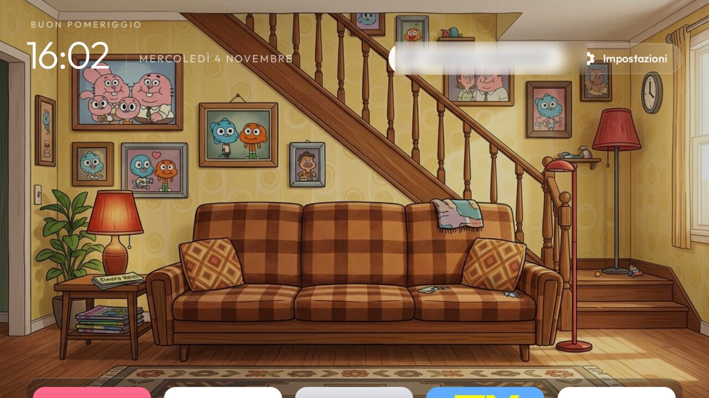
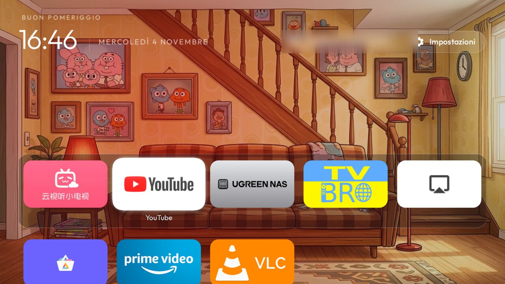
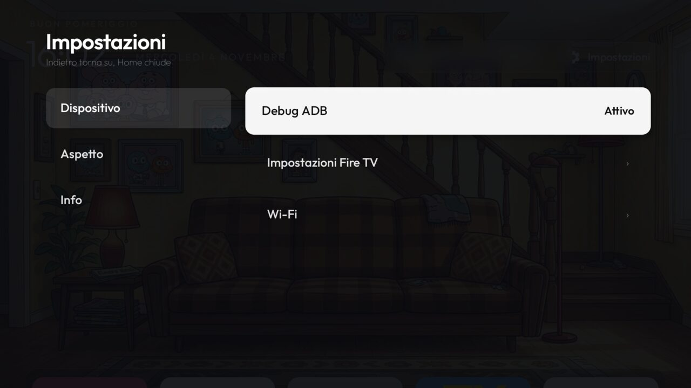
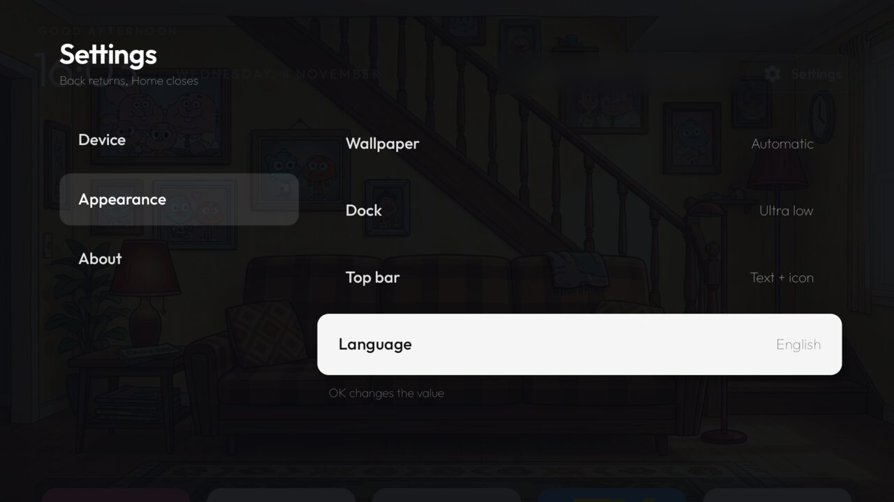
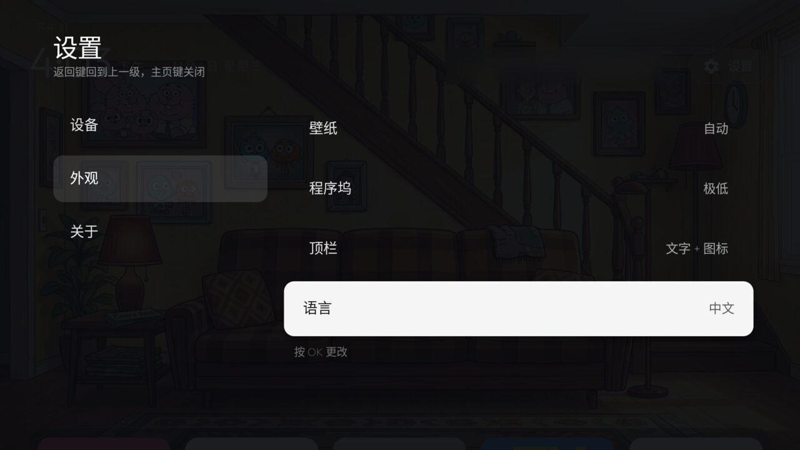
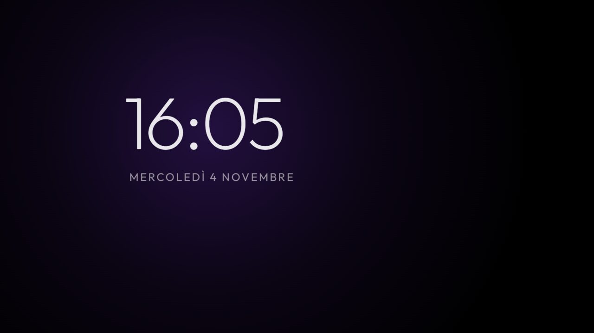

# tv-vibehack for Fire OS

A clean, Apple TV–style home screen that actually takes over **Home on an Amazon Fire TV Stick**,
plus an ad-free debloat list for it.

This is an alternative version built on two projects:

- [**benfirad/tv-vibehack**](https://github.com/benfirad/tv-vibehack): the launcher this repo was forked from.
- [**Gathin23/cleanyourtv**](https://github.com/Gathin23/cleanyourtv): the original project tv-vibehack forked.

Both are MIT-licensed; so is this. The original README is kept in [`docs/upstream-README.md`](docs/upstream-README.md).

Tested on a Fire TV Stick 4K (`AFTKM`), Fire OS 8.1.8.2 (Android 11).

| Home | Dock |
|---|---|
|  |  |
| **Settings: Device** | **Settings: Appearance** |
|  |  |
| **中文** | **Clock screensaver** |
|  |  |

## What it does on Fire OS

- **Takes Home back from Amazon.** Fire OS won't let another app become the default home and protects
  its own launcher, so an accessibility service brings this launcher to the front whenever Amazon's home
  appears.
  - The switch happens at once, with no window animation. The launcher has focus about 0.28 s after
  Amazon's home starts (was 0.89 s).
  - Fire OS keeps the Home key itself from apps (checked with a key-logging build: Down, Right and Back
  arrive, Home never does), so Amazon's window appearing is the earliest possible signal.
- **Fire OS settings still open.** Fire OS opens Settings through Amazon's home, so the launcher lets
  that one pass through.
  - Back from Fire TV settings or Wi-Fi returns to the launcher's Settings panel; Home goes to the home screen.
- **Two-pane Settings** with a hierarchy: Device / Appearance / About.
  - **Debug ADB is a real switch.** It flips `adb_enabled` directly (the install script grants
  `WRITE_SECURE_SETTINGS`).
  - Without that permission, it opens Amazon's Developer Options straight on the Debug ADB row. That
  screen was found by reverse-engineering Amazon's Settings app.
- **Clock screensaver** replaces Amazon's, using the same idle timer. It shows a page from the home NAS when the NAS can be reached (`ClockDream.TV_URL`), and the clock otherwise.
- **Phone control**: Settings > Appearance > Phone control shows a QR. The page it opens reorders, renames and hides tiles and types into the field selected on the TV. Local network only, plain HTTP, random code in the address; it stops after 30 idle minutes.
- **Scheduled wake** (off by default): at the time set in `config.xml` the stick wakes the television over HDMI-CEC and opens that page, unless another app is in use. After 90 minutes without a key press it goes back to standby (`WakeSchedule`, `TvPageActivity`).
- **Launcher language**: English, Italiano, 中文 (Simplified), independent of the TV's language.
- **Apple TV–style motion**: critically damped springs, a slight tilt toward the D-pad direction,
  press-in on OK. Only transform and opacity are animated, and the TV's animation scale is respected.
- **Small**: release build with R8 and resource shrinking, **≈ 0.75 MB** (the debug build was 3.6 MB).
  Network use: the IPTV picker's playlist download and the NAS page on the local network.
- **Debloat list** for the AFTKM: [`examples/amazon-fire-tv-stick-4k-aftkm/debloat.txt`](examples/amazon-fire-tv-stick-4k-aftkm/debloat.txt).
  - 58 packages, disabled and never uninstalled: the original 21 plus 37 from cleanyourtv's list for the same model.
  - Amazon's own home can't be removed on a locked stick: [why](docs/what-we-did.md#9-can-amazons-home-be-removed-nov-4).

## Since Nov 5

- **Shortcut tiles** (`shortcuts` in `config.xml`): a web page or stream as its own tile, e.g. a web page in TV Bro.
- **IPTV channel picker**: the IPTV tile (or the remote's TV / Guide button) lists a playlist's channels by group.
  OK plays in VLC, Right tries the next source, Back from VLC returns to the list.
- **Tile menu** (hold OK or ☰ on a tile): Move (also changes the dock), Hide, App info, Uninstall.
  Settings → Appearance → Hidden apps brings hidden tiles back.
- **Home without Amazon's flash**: the system log triggers the redirect under a black cover.
  Amazon home → launcher went from a median of 173 ms to 45 ms, at no measurable CPU cost.
- **Top shelf** (the focused dock app's name in large type), an optional **stats line** (free RAM and storage),
  and **phone-only apps** you installed.
- Fixes: stuck on Amazon's home after Wi-Fi + Home, tiles not updating after installs, dock depth, focus after Home.
- Details: [`docs/what-we-did.md`](docs/what-we-did.md#11-wishlist-and-fixes-nov-5), wishlist status in [`docs/wishlist.md`](docs/wishlist.md).

## Compared with cleanyourtv

cleanyourtv (v3.3, Nov 2026; checked against its code on Nov 4) is the far bigger project: hundreds of TV models, 31 languages, themes and
add-ons. On Fire TV, though, its README says it does **"the debloat half only, since Fire OS will not hand
Home to a third-party launcher"**. That missing half is what this version adds.

| | cleanyourtv 3.3 | This version |
|---|---|---|
| **Scope** | Any Android / Google TV; Fire TV debloat lists for many models | Fire TV Stick 4K (AFTKM), one owner's setup |
| **Home on Fire TV** | Documented as debloat only. Its generic `stock_home_redirect` (Oct 2026, for XGIMI / TCL / Google TV firmware that turns the stock launcher back on) uses the same window-based idea, but has no Fire OS Settings pass-through or Back handling | Taken over via the accessibility redirect, with Settings pass-through and Back handling |
| **Home redirect speed** | n/a | Launcher focused ~0.28 s after Amazon's home starts |
| **Fire OS settings from the launcher** | n/a on Fire TV | Pass-through; Back returns to the Settings panel |
| **Settings on the TV** | Hold OK on Settings → launcher settings page | Two-pane panel: Device / Appearance / About |
| **ADB on/off** | Through the TV's own menus | One switch in Settings (`WRITE_SECURE_SETTINGS`); falls back to Amazon's Debug ADB screen |
| **Languages** | 31, follows the TV, right-to-left for Hebrew | 3 chosen in the launcher (en / it / zh) + German strings from tv-vibehack |
| **Themes / module cards / add-ons** | Yes (21 themes, cards, add-ons) | No |
| **App library, tile menu (move / remove)** | Yes | Long-press = App info only |
| **Inputs (HDMI / AV / Live TV)** | Yes | Hidden: a stick has none |
| **Clock screensaver** | Drifting clock | Clock with a slow colour glow; replaces Amazon's |
| **Size** | ≈ 572 KB | ≈ 0.75 MB (includes 1376×768 wallpapers) |
| **Network permission** | None | None |
| **Rollback** | `tools/restore.*` | Same, plus [`tools/rollback-firetv.sh`](tools/rollback-firetv.sh): reinstalls a saved earlier build and the old screensaver settings |

**In short:** on any Android or Google TV, use cleanyourtv. On a Fire TV, cleanyourtv's debloat list plus
this launcher gives you the home screen back.

Testing showed that cleanyourtv's own launcher can do the same on Fire OS through `stock_home_redirect`; only its install
script stopped short. [PR #3276](https://github.com/Gathin23/cleanyourtv/pull/3276) fixes that upstream (open, waiting
for a maintainer).

## Compared with tv-vibehack

[benfirad/tv-vibehack](https://github.com/benfirad/tv-vibehack) is the base: this repo starts from its `main`
(last changed 2026-10-19) and is 30 commits ahead, 0 behind. 64 files changed, +2,383 / −1,488.

| | tv-vibehack `main` | This version |
|---|---|---|
| **Builds as-is** | No: duplicate image resources break the build (fixed here, sent as [PR #1](https://github.com/benfirad/tv-vibehack/pull/1)) | Yes |
| **Fire TV** | Not supported: Home stays Amazon's | Home override through an accessibility service, Settings pass-through, Back handling, AFTKM debloat list (sent as [PR #5](https://github.com/benfirad/tv-vibehack/pull/5)) |
| **Settings** | One overlay of button groups: top bar style, dock level, wallpaper, Fire OS shortcuts | Two panes with a hierarchy: Device / Appearance / About |
| **ADB** | Only through the TV's own menus | On/off switch in Settings, falls back to Amazon's Debug ADB screen |
| **Top bar** | Calendar, Wi-Fi, Settings pills | Wi-Fi, Settings (calendar removed) |
| **Stremio** | Shelf with five sample banners | Removed |
| **Screensaver** | `ClockDream` class present but not registered, so it can't be chosen | Registered and set as the system screensaver by the install script |
| **Languages** | English, German | English, Italiano, 中文 chosen in Settings (German strings kept) |
| **Motion** | Duration-based focus animations | Critically damped springs, tilt toward the D-pad direction, press-in on OK; respects the TV's animation scale |
| **Focus highlight** | Could appear above the dock for a moment on Down from the top bar | Waits until the dock has settled |
| **Release build** | No shrinking (≈ 3.5 MB) | R8 + resource shrinking, wallpapers recompressed: ≈ 0.75 MB |
| **Permissions** | Includes INTERNET | INTERNET only for the IPTV playlist; WRITE_SECURE_SETTINGS (ADB switch) and READ_LOGS (Home without Amazon's flash), both granted by the install script |
| **Unit tests** | None | 28 JVM tests for the logic (choices, ADB fallbacks, language defaults, Back vs Home, highlight placement) |
| **Rollback** | `tools/restore*` | Plus [`tools/rollback-firetv.sh`](tools/rollback-firetv.sh) to go back to a saved earlier build |

## Install (Fire TV)

1. On the TV: Settings → My Fire TV → About → press OK on the device name 7 times → Developer Options →
   **ADB debugging** on.
2. Debloat: see [`docs/fire-tv.md`](docs/fire-tv.md).
3. Build and install (JDK 17, Android SDK 34):

   ```bash
   TV_HOST=<fire-tv-ip> launcher/build-and-install-firetv.sh
   ```

   It builds the release APK, installs it, grants `WRITE_SECURE_SETTINGS`, sets the Clock screensaver
   and enables the Home override.
4. Turn ADB off afterwards: Settings → Device → Debug ADB.

Personal choices live in [`launcher/app/src/main/res/values/config.xml`](launcher/app/src/main/res/values/config.xml):
dock apps, hidden apps, columns.

## Wallpapers

The two built-in wallpapers (`launcher/app/src/main/res/drawable-nodpi/wallpaper_day.jpg` and
`wallpaper_night.jpg`) come from tv-vibehack, only recompressed here. They show characters from
*The Amazing World of Gumball*, which belongs to Cartoon Network / Warner Bros. Discovery. They are fan art:
not covered by this repo's MIT licence, and not ours to license. If you build on or redistribute this, replace
them with your own images (same file names, 16:9 JPEG).

## How it was made

The full account, including measurements, the upstream contributions and what is still open, is in
[`docs/what-we-did.md`](docs/what-we-did.md).
